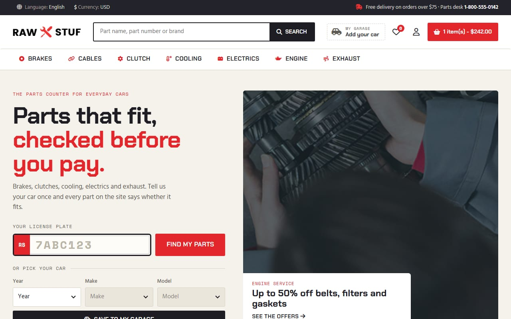

# Rawstuf: free auto parts store website template (HTML5, Bootstrap 5)

An online auto parts store template with a year, make and model finder, by
[ThemeVault](https://www.themevault.net/?utm_source=github&utm_medium=referral&utm_campaign=rawstuf).
Rebuilt in 2026 as version 2.0, "Fitment Counter".

**[Live demo](https://demo.themevault.net/rawstuf/)** ·
**[Template page](https://www.themevault.net/rawstuf-auto-parts-website-template?utm_source=github&utm_medium=referral&utm_campaign=rawstuf)**

## What's in it

- **Find parts by vehicle:** pick a year, then a make, then a model (or search by licence plate). The car is saved to
  "My garage" in the browser, and every product shows whether it fits.
- **Fitment data on every product**, by make, model and year range, with the vehicle list in its own file
  (`js/vehicles.js`), so you can swap in your own makes and models without touching the pages.
- **A complete shop front:** product listing with category filters, sorting, a fit-only filter and grid/list views;
  a product page with gallery, part number, trade pricing, quantity, specification table, reviews and related parts;
  cart, checkout and an order confirmation page.
- **13 pages and 6 HTML emails:** home, product list, product, product details, cart, checkout, order confirmed, login,
  register, about, contact, delivery and returns, and a 404 page; emails for order confirmation, newsletter welcome,
  account welcome, review received, contact auto-reply and password reset.
- **Every form validates** and shows a success message, including reviews, register, login, forgotten password,
  coupon, shipping estimate and gift certificate.
- **Bootstrap 5 and Font Awesome 6**, with jQuery and Owl Carousel replaced by plain JavaScript and the fonts
  (Chakra Petch, Hind, Space Mono) hosted locally.

## Use it

1. Download or clone this repository.
2. Replace the sample parts, prices and vehicles with your own (`js/vehicles.js` holds the vehicle list). The photos in
   this package are blurred placeholders: use your own.
3. Upload the folder to any web host. It's plain HTML, CSS and JavaScript, with no build step.

**Taking real orders:** the cart and checkout work in the visitor's browser, but no order reaches you until you
connect a payment or cart service (for example Stripe Payment Links or Snipcart) and point the forms at a form
service or your own server.

## Licence

**Free for personal and commercial use**, for your own or your clients' websites, as long as the "Designed by
ThemeVault" credit link in the footer stays in place. You can remove the credit for this template with a one-time
credit removal on the
[template page](https://www.themevault.net/rawstuf-auto-parts-website-template?utm_source=github&utm_medium=referral&utm_campaign=rawstuf),
or on every template with Pro.

This is **not an open-source licence**: you may not resell or redistribute the template, modified or not, as a
template or in a template collection. Full terms: [License.txt](License.txt) and
[themevault.net/license](https://www.themevault.net/license).

More free templates: [themevault.net](https://www.themevault.net/?utm_source=github&utm_medium=referral&utm_campaign=rawstuf)
